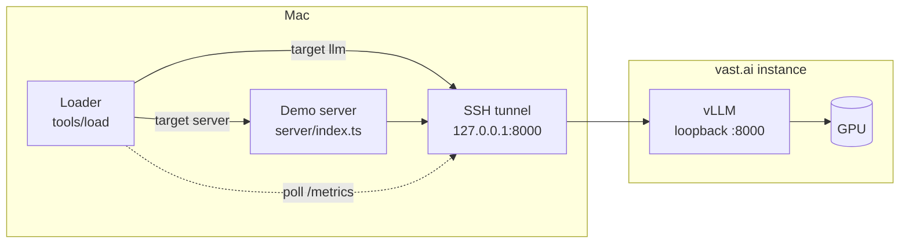
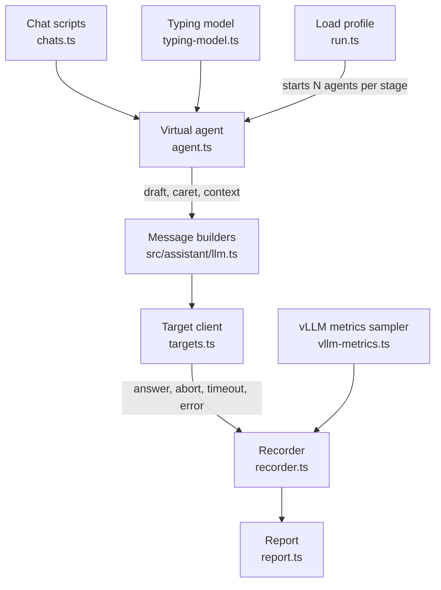
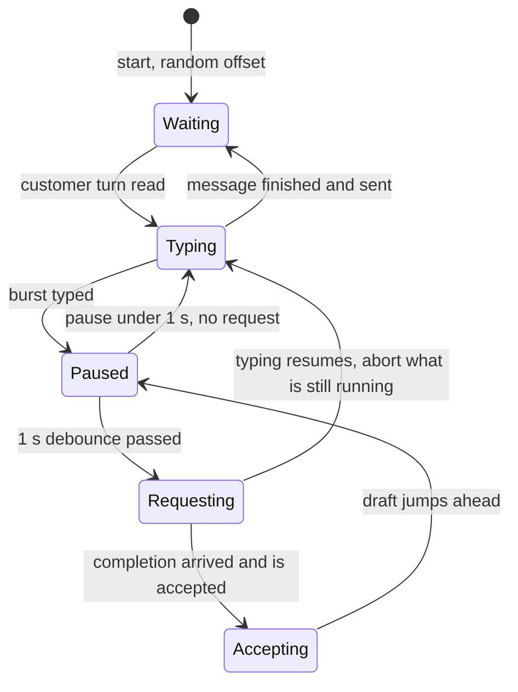

# Load test: loader architecture

Design for a load generator that sends the demo's real traffic shape to an LLM served by vLLM on a rented vast.ai GPU. Nothing here is built yet. Written 2026-11-10.

## Goal

Answer one question per model and GPU: **how many agents typing at once can one instance serve before the answers stop arriving in time?**

The loader simulates agents, not requests. Each simulated agent types a message, pauses, sends the two requests the assistant would send, and either waits for the answers or resumes typing and aborts them.

## What already exists

From the sibling project `../SpellCheckingPrototype`, used as is:

| Asset | Where | Use in the load test |
|---|---|---|
| vast.ai scripts | `deploy/vastai/` (`search`, `start`, `tunnel`, `check`, `status`, `destroy`) | Rent the GPU, serve the model on vLLM v0.31.0, open the SSH tunnel to `127.0.0.1:8000`, check it, stop billing. `start.sh --max-seqs N` sets vLLM's cap on concurrent sequences |
| Synthetic support chats | `eval/completion/sources/support-en.txt` (43 conversations, 137 agent turns) and `support-ar.txt` (55 conversations, 173 agent turns) | The text the simulated agents type, and the conversation each request carries. Synthetic, so it may go to a rented machine |
| Tester telemetry | `telemetry/events.jsonl` (27 sessions) | Source of the default typing numbers below |
| Model choice and latency notes | `docs/LLM-SELECTION.md`, `docs/VASTAI-GPU.md` | Which model to load (the candidate that passes the gate is `google/gemma-4-26B-A4B-it`, 385–405 ms p50 for a single user on an RTX PRO 6000 WS at $1.43/h) |

From this project, imported by the loader:

| Asset | Where | Use |
|---|---|---|
| User message builders and answer parsers | `src/assistant/llm.ts` | The requests are byte-for-byte what the assistant sends; the parsers give the format-error rate under load |
| Upstream client with the prompts | `server/openai-chat-client.ts` | Direct calls to vLLM with the real system messages and examples |
| Context blocks | `src/app/lib/presets.ts` | Canned responses and knowledge base around the conversation, so the prompt has its real size |
| Node resolve hook pattern | `tools/eval/` | Running TypeScript that imports `src/` without a build |

## Topology



Two targets, one flag:

- **`--target llm`** calls vLLM directly through the tunnel. It measures the model and the GPU.
- **`--target server`** calls the demo server's `/api/autocorrection` and `/api/autocompletion` with Basic auth. It measures the whole path and shows what the server adds, including the upstream calls it does not cancel (finding 1 in `server-architecture-and-review.md`).

Settings for vLLM as this project's LLM: `LLM_URL=http://127.0.0.1:8000/v1/chat/completions`, `MODEL=<Hugging Face id>`, `LLM_API_KEY=` any non-empty value.

## Components



Planned files, all under `tools/load/`:

| File | Responsibility |
|---|---|
| `run.ts` | Command line, the stages, starting and stopping agents, the final report |
| `chats.ts` | Reads the chat sources into scripts: for each agent turn, the text to type and the conversation before it. The English file labels turns `Customer:` and `Agent:`, the Arabic file `العميل:` and `الموظف:`; conversations are separated by `---` |
| `typing-model.ts` | The numbers that drive an agent, drawn from a seeded random generator so a run can be repeated |
| `agent.ts` | One simulated agent: the loop below |
| `targets.ts` | Two `LLMClient`s: the upstream client for vLLM, and an HTTP client for the demo server |
| `vllm-metrics.ts` | Polls vLLM's `/metrics` every 2 s: requests running and waiting, token counters |
| `recorder.ts` | One line per request in `runs/<time>/requests.jsonl` |
| `report.ts` | Per-stage figures, as `report.md` and `report.json` |

Pure parts (`chats.ts`, `typing-model.ts`, `report.ts`) get `*.spec.ts` files next to them, run in Node like the assistant's tests.

### The virtual agent

It follows the assistant's own rules (`src/assistant/check-while-typing.ts`), so the request pattern is the real one.



- **Typing** adds the next few words of the script to the draft, with typos inserted at a set rate so the spell check has something to report. The loader has its own small seeded typo injector: the sibling's `eval/inject.ts` depends on its Hunspell pipeline and is not reused.
- **Requesting** sends spell check and auto-completion in parallel under one abort controller, with the assistant's 20 s timeout. A share of rounds send spell check only, standing in for edits in the middle of the text.
- **Resume** happens when the pause ends. Any request still running is aborted, as the assistant does on the next keystroke.
- **Accepting** a completion moves the draft ahead by the completion's length and starts a new debounce, as Tab does in the page.
- **Waiting** is the time between messages: the customer's reply and reading it.

### Assumed defaults

Every number is a flag. The loader prints the gaps it actually produced so they can be compared with real data later.

| Setting | Default | Basis |
|---|---|---|
| Debounce | 1000 ms | `DEBOUNCE_MS` in this project |
| Request timeout | 20 s | `LLM_TIMEOUT_MS` in this project |
| Typing speed | 40 words per minute, ±25% per agent | Assumed |
| Burst length | Median 3 words | Assumed, tuned so the gap between rounds lands near the telemetry figure |
| Pause after a burst | Median 1.8 s, long tail | Assumed |
| Gap between request rounds (result, not input) | Median about 6 s | Telemetry: median 5.7 s, quartiles 2.8 s and 15.3 s between completions in a session. That prototype triggers differently, so this is a rough guide |
| Completion accepted | 26% of those shown | Telemetry: 85 accepted of 329 shown |
| Spell check only rounds | 10% | Assumed |
| Typos | 1 per 15 words | Assumed |
| Time between messages | Median 20 s | Assumed |
| Language mix | Half English, half Arabic | Assumed |

### Load profile

Agents are the unit of load, in steps:

```
--agents 10,25,50,100,150 --stage 180
```

- Each stage adds agents up to its level and holds for the stage time.
- New agents start at random offsets so they do not pause in step.
- The first 30 s of each stage is warm-up and left out of the figures.
- Every stage runs to its end. There is no early stop.

### What is recorded

Per request: stage, agent, kind, language, outcome, latency, the time the agent gave it before resuming, prompt and answer size, and whether the answer parsed.

Outcomes: `answered`, `aborted`, `timeout`, `error`, `unreadable`. A context-length rejection from vLLM is reported apart from other errors (the start script serves an 8,192-token context).

Per 2 s sample from vLLM: requests running, requests waiting, prompt and generation token counters. The exact metric names are to be confirmed against v0.31.0.

A small probe request (one output token) every 10 s gives the network and tunnel round trip, so model time can be told from distance to the host.

### Report

One row per stage:

| Figure | Meaning |
|---|---|
| Agents, rounds per second, requests in flight (mean, max) | The load actually applied |
| **Useful answer rate**, per kind | Share of requests answered before the agent resumed typing. The headline figure |
| Latency p50, p95, p99, per kind | For answered requests |
| Aborted, timed out, failed, unreadable | Shares of all requests |
| vLLM queue (max waiting) and tokens per second | Whether the GPU is saturated |
| Network round trip | From the probe |

With `--price <$/h>` each row also gives the cost per agent-hour at that level.

There is no pass rule and no verdict. The report gives the figures; where the knee is, is read from them by a person.

## Running it

```sh
# in ../SpellCheckingPrototype
deploy/vastai/search.sh --min-gb 80
deploy/vastai/start.sh <offer-id> google/gemma-4-26B-A4B-it
deploy/vastai/tunnel.sh            # own terminal, kept open
deploy/vastai/check.sh

# in this project
npm run load -- --target llm --agents 10,25,50,100,150 --stage 180 --price 1.43
npm run load -- --target server --agents 10,25,50 --stage 180

# in ../SpellCheckingPrototype, always
deploy/vastai/destroy.sh
```

Runs land in `tools/load/runs/<time>/` (git-ignored).

**Trying the loader without a GPU.** Until an instance is rented, the loader runs against a hosted Gemini model through its OpenAI-compatible chat completions endpoint: `LLM_URL` set to that endpoint, `MODEL` to the Gemini model (the sibling project uses `gemini-3.5-flash-lite`), `LLM_API_KEY` to the Gemini key, all in the git-ignored `.env`. Keep it to a few agents, since a hosted model has rate limits. Such a run shows the loader works and says nothing about capacity. There are no vLLM metrics in it.

## Decisions

Taken on 2026-11-10:

- **No pass rule.** The measures in the report are the result. No verdict, no early stop.
- **Capacity runs use `google/gemma-4-26B-A4B-it`** on one 96 GB card.
- **The first changes are tried against Gemini**, as above.
- **The work goes through OpenSpec** on the branch `load-test-openspec` (`openspec/config.yaml` holds the context and the rules).

## Planned changes

Each row is one OpenSpec change. The first two need no rented GPU.

| # | Change | What it delivers | Needs |
|---|---|---|---|
| 1 | `load-generator` | The loader in `tools/load/` with the `llm` target: chat parser for both sources, seeded typing model and typo injector, virtual agent, recorder, per-stage report, spec files for the pure parts, `npm run load` | Gemini key, a few cents |
| 2 | `load-server-target` | The `server` target: the demo server's two routes with Basic auth, so the whole path can be loaded | Gemini key |
| 3 | `vllm-metrics` | The vLLM `/metrics` sampler, the network probe, context-length rejections reported apart, cost per agent-hour from `--price` | About 1 GPU hour to confirm the metric names |
| 4 | `first-capacity-run` | The stepped run on the chosen model, the check that aborts reach vLLM through the tunnel, the results written into `docs/` | 2–3 GPU hours, roughly $3–5 |
| 5 | `server-cost-fixes` | Two product changes, each measured before and after: cancel the upstream call when the browser disconnects, and cap the answer's tokens | GPU hours for the comparison runs |
| 6 | `capacity-variations` | Runs with one setting changed each: prefix cache, JSON mode, `--max-seqs` | GPU hours |

Possible later: replace the assumed typing numbers with sessions recorded from the demo's Debugger.

Changes 5 and 6 depend on what change 4 shows and may be reordered or dropped.

## Things the first runs should settle

- **Do aborts reach vLLM through the tunnel?** Closing the local connection should close the SSH channel and stop generation. The vLLM running count dropping right after a burst of aborts confirms it.
- **Prefix caching.** The system message and examples are the same for every request, and the context is the same for one agent across a message. Compare a run with vLLM's prefix cache on and off.
- **JSON mode cost.** This project sends `response_format: json_object`. Compare tokens per second with and without it.
- **No output cap.** This project sends no `max_tokens`. Under load a few long answers hold a slot each; a run with a cap shows how much that matters.
- **`--max-seqs`.** vLLM's default of 256 concurrent sequences may be above or below what the card serves well. Past the knee, try a lower cap and see whether queueing beats slow generation.

## Limits of this design

- **The typing model is assumed.** The capacity figure is only as good as the gap and pause numbers. Real figures from Agent Desktop, or recorded Debugger sessions from this demo, should replace them.
- **One language model, one instance.** No autoscaling, no failover, no second replica.
- **The loader runs on the Mac.** The tunnel is one SSH connection. That is enough for this volume (a few kilobytes per request), and the probe shows its share. A run from a second instance next to the GPU would remove it, at the cost of installing Node there.
- **Synthetic text only.** A vast.ai instance is someone else's machine; the loader reads only the synthetic chats and the presets.
