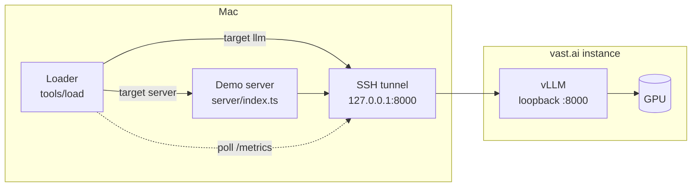
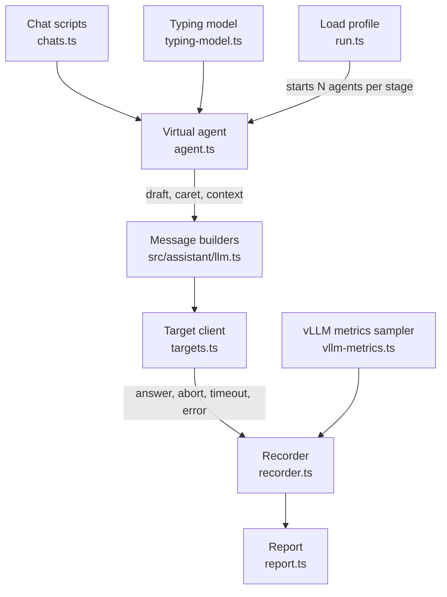
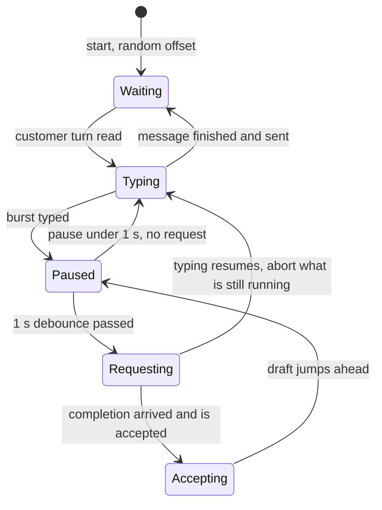

# Load test: loader architecture

Design for a load generator that sends the demo's real traffic shape to an LLM served by vLLM on a rented vast.ai GPU. Written 2026-11-10. The core (change `load-generator`: scripts, agent, run, report, the `llm` and `fake` targets) is built; see [As built](#as-built-change-load-generator). The `server` target is built too (change `load-server-target`, see [The server target](#the-server-target-change-load-server-target)). The vLLM metrics, the probe and the cost figures are built and checked against fakes (change `vllm-metrics`, see [vLLM metrics, probe and cost](#vllm-metrics-probe-and-cost-change-vllm-metrics)); their names still need confirming on a rented instance.

## Goal

Answer one question per model and GPU: **how many agents typing at once can one instance serve before the answers stop arriving in time?**

The loader simulates agents, not requests. Each simulated agent types a message, pauses, sends the two requests the assistant would send, and either waits for the answers or resumes typing and aborts them.

## What already exists

From the sibling project `../SpellCheckingPrototype`, used as is:

| Asset | Where | Use in the load test |
|---|---|---|
| vast.ai scripts | `deploy/vastai/` (`search`, `start`, `tunnel`, `check`, `status`, `destroy`) | Rent the GPU, serve the model on vLLM v0.31.0, open the SSH tunnel to `127.0.0.1:8000`, check it, stop billing. `start.sh --max-seqs N` sets vLLM's cap on concurrent sequences |
| Synthetic support chats | `eval/completion/sources/support-en.txt` (43 conversations, 137 agent turns) and `support-ar.txt` (55 conversations, 173 agent turns) | The text the simulated agents type, and the conversation each request carries. Synthetic, so it may go to a rented machine |
| Tester telemetry | `telemetry/events.jsonl` (27 sessions) | Source of the default typing numbers below |
| Model choice and latency notes | `docs/LLM-SELECTION.md`, `docs/VASTAI-GPU.md` | Which model to load (the candidate that passes the gate is `google/gemma-4-26B-A4B-it`, 385–405 ms p50 for a single user on an RTX PRO 6000 WS at $1.43/h) |

From this project, imported by the loader:

| Asset | Where | Use |
|---|---|---|
| User message builders and answer parsers | `src/assistant/llm.ts` | The requests are byte-for-byte what the assistant sends; the parsers give the format-error rate under load |
| Upstream client with the prompts | `server/openai-chat-client.ts` | Direct calls to vLLM with the real system messages and examples |
| Context blocks | `src/app/lib/presets.ts` | Canned responses and knowledge base around the conversation, so the prompt has its real size |
| Node resolve hook pattern | `tools/eval/` | Running TypeScript that imports `src/` without a build |

## Topology



Two targets, one flag:

- **`--target llm`** calls vLLM directly through the tunnel. It measures the model and the GPU.
- **`--target server`** calls the demo server's `/api/autocorrection` and `/api/autocompletion` with Basic auth. It measures the whole path and shows what the server adds, including the upstream calls it does not cancel (finding 1 in `server-architecture-and-review.md`).

Settings for vLLM as this project's LLM: `LLM_URL=http://127.0.0.1:8000/v1/chat/completions`, `MODEL=<Hugging Face id>`, `LLM_API_KEY=` any non-empty value.

## Components



Planned files, all under `tools/load/`:

| File | Responsibility |
|---|---|
| `run.ts` | Command line, the stages, starting and stopping agents, the final report |
| `chats.ts` | Reads the chat sources into scripts: for each agent turn, the text to type and the conversation before it. The English file labels turns `Customer:` and `Agent:`, the Arabic file `العميل:` and `الموظف:`; conversations are separated by `---` |
| `typing-model.ts` | The numbers that drive an agent, drawn from a seeded random generator so a run can be repeated |
| `agent.ts` | One simulated agent: the loop below |
| `targets.ts` | Two `LLMClient`s: the upstream client for vLLM, and an HTTP client for the demo server |
| `vllm-metrics.ts` | Polls vLLM's `/metrics` every 2 s: requests running and waiting, token counters |
| `recorder.ts` | One line per request in `runs/<time>/requests.jsonl` |
| `report.ts` | Per-stage figures, as `report.md` and `report.json` |

Pure parts (`chats.ts`, `typing-model.ts`, `report.ts`) get `*.spec.ts` files next to them, run in Node like the assistant's tests.

### The virtual agent

It follows the assistant's own rules (`src/assistant/check-while-typing.ts`), so the request pattern is the real one.



- **Typing** adds the next few words of the script to the draft, with typos inserted at a set rate so the spell check has something to report. The loader has its own small seeded typo injector: the sibling's `eval/inject.ts` depends on its Hunspell pipeline and is not reused.
- **Requesting** sends spell check and auto-completion in parallel under one abort controller, with the assistant's 20 s timeout. A share of rounds send spell check only, standing in for edits in the middle of the text.
- **Resume** happens when the pause ends. Any request still running is aborted, as the assistant does on the next keystroke.
- **Accepting** a completion moves the draft ahead by the completion's length and starts a new debounce, as Tab does in the page.
- **Waiting** is the time between messages: the customer's reply and reading it.

#### The agent against the assistant's rules

Each rule of `src/assistant/check-while-typing.ts` (and the timeout in `src/assistant/llm.ts`), as built in `tools/load/agent.ts`:

| Rule in the assistant | In the agent |
|---|---|
| The debounce restarts on every input, so a round starts `debounceMs` after the last keystroke | Followed: a round starts `--debounce-ms` after the end of a burst; a shorter pause sends nothing |
| Spell check and auto-completion go out together under one `AbortController` | Followed: one controller per round, both requests sent at the same moment |
| An input aborts the running request (`abortRunningRequest` on text change) | Followed: resuming typing at the pause end aborts what is still running, and so does accepting a completion |
| Each request is ended after `LLM_TIMEOUT_MS` (20 s) | Followed: `--timeout-ms`, ended as `timeout` |
| Auto-completion is asked only when the rest of the caret line is blank | Followed: with the caret at the end of the draft both are sent; a spell check only round puts the caret at an earlier word end and sends spell check alone |
| An empty field sends nothing | Followed by construction: a round always follows a burst, so the draft is never empty |
| Accepting a completion (Tab) inserts text, which is an input: a new debounce and a new round | Followed: the draft moves ahead and a new pause starts; the inserted words are the script's, not the model's |
| `isCaretOnNewLine` adds a line to the auto-completion message | Left out: drafts are one line, so it is always false |
| Typing the letters of the shown completion keeps it and sends no new request | Left out: a completion is accepted whole or not at all |
| Auto-correction changes the text without a new request | Left out: the draft keeps its typos, so spell check answers are a little longer than in real use |
| Undo and redo send no new request | Left out: no undo or redo |
| Deleting only trailing spaces sends no new request | Left out: the agent never deletes |
| Escape clears the debounce and aborts the running request | Left out: no Escape |
| An input method still composing blocks auto-completion | Left out: no input methods |
| Spell check or auto-completion can be switched off | Left out: both are always on |
| Answers are dropped when the text or the caret moved while waiting | No effect on load: the request has already been served |

### Assumed defaults

Every number is a flag. The loader prints the gaps it actually produced so they can be compared with real data later.

| Setting | Default | Basis |
|---|---|---|
| Debounce | 1000 ms | `DEBOUNCE_MS` in this project |
| Request timeout | 20 s | `LLM_TIMEOUT_MS` in this project |
| Typing speed | 40 words per minute, ±25% per agent | Assumed |
| Burst length | Median 3 words | Assumed, tuned so the gap between rounds lands near the telemetry figure |
| Pause after a burst | Median 1.8 s, long tail | Assumed |
| Gap between request rounds (result, not input) | Median about 6 s | Telemetry: median 5.7 s, quartiles 2.8 s and 15.3 s between completions in a session. That prototype triggers differently, so this is a rough guide |
| Completion accepted | 26% of those shown | Telemetry: 85 accepted of 329 shown |
| Spell check only rounds | 10% | Assumed |
| Typos | 1 per 15 words | Assumed |
| Time between messages | Median 20 s | Assumed |
| Language mix | Half English, half Arabic | Assumed |

### Load profile

Agents are the unit of load, in steps:

```
--agents 10,25,50,100,150 --stage 180
```

- Each stage adds agents up to its level and holds for the stage time.
- New agents start at random offsets so they do not pause in step.
- The first 30 s of each stage is warm-up and left out of the figures.
- Every stage runs to its end. There is no early stop.

### What is recorded

Per request: stage, agent, kind, language, outcome, latency, the time the agent gave it before resuming, prompt and answer size, and whether the answer parsed.

Outcomes: `answered`, `unreadable`, `aborted`, `timeout`, `failed`, `cut` (defined under [As built](#as-built-change-load-generator)). Planned with `vllm-metrics`: a context-length rejection from vLLM is reported apart from other errors (the start script serves an 8,192-token context).

Per 2 s sample from vLLM: requests running, requests waiting, prompt and generation token counters. The exact metric names are to be confirmed against v0.31.0.

A small probe request (one output token) every 10 s gives the network and tunnel round trip, so model time can be told from distance to the host.

### Report

One row per stage:

| Figure | Meaning |
|---|---|
| Agents, rounds per second, requests in flight (mean, max) | The load actually applied |
| **Useful answer rate**, per kind | Share of requests answered before the agent resumed typing. The headline figure |
| Latency p50, p95, p99, per kind | For answered requests |
| Aborted, timed out, failed, unreadable | Shares of all requests |
| vLLM queue (max waiting) and tokens per second | Whether the GPU is saturated |
| Network round trip | From the probe |

With `--price <$/h>` each row also gives the cost per agent-hour at that level.

There is no pass rule and no verdict. The report gives the figures; where the knee is, is read from them by a person.

## As built (change `load-generator`)

### Command and flags

```sh
npm run load -- --agents <levels> [flags]
npm run load -- --target fake --agents 2,5 --stage 60 --warmup 10   # dry run: two minutes, no network, no key
```

Run flags:

| Flag | Default | Meaning |
|---|---|---|
| `--agents` | required | Agents per stage, one number or rising numbers: `2,5,10` |
| `--target` | `llm` | `llm`: the server's upstream client (`server/openai-chat-client.ts`) with `LLM_URL`, `MODEL`, `LLM_API_KEY` from `.env` or the environment, sending exactly what the server sends. `server`: the demo server, started by the loader with those settings (below). `fake`: built in, one seeded fake per agent, no network |
| `--stage` | 180 | Seconds per stage |
| `--warmup` | 30 | Seconds at the start of each stage left out of the figures; 0 or more, less than `--stage` |
| `--seed` | 1 | Seed of all draws |
| `--chats` | `../SpellCheckingPrototype/eval/completion/sources` | Chat sources folder |
| `--max-requests` | none | Stop once this many requests have been sent |
| `--out` | `tools/load/runs` | Where run folders are made |
| `--trace` | off | Also write `trace.jsonl` with each user message and raw answer |
| `--model`, `--url` | from the environment | Override `MODEL` and `LLM_URL` |
| `--fake-latency-ms` | 600 | Median latency of the fake target (log-normal, spread 0.5) |

Typing flags (assumed, listed in every report): `--debounce-ms 1000`, `--timeout-ms 20000`, `--wpm 40`, `--burst-words 3`, `--pause-ms 1800`, `--accept-share 0.26`, `--spell-check-only-share 0.1`, `--typo-every 15`, `--between-messages-ms 20000`, `--arabic-share 0.5`. A negative value must be written `--pause-ms=-5` to reach the range check; Node's parser reads `-5` alone as a flag and stops with an error naming it.

Spreads, fixed in `typing-model.ts`: speed ±25% per agent (uniform), words per burst log-normal 0.5 (rounded, at least 1), pause 0.7, time between messages 0.6. Each new agent starts after a delay drawn over the warm-up (at most 30 s).

### Outcomes

Decided from the agent's own signals, never from error text:

| Outcome | Meaning |
|---|---|
| `answered` | The answer arrived before the agent resumed and before the timeout, and parsed |
| `unreadable` | It arrived in time and did not parse |
| `aborted` | The agent resumed typing, or accepted a completion, first |
| `timeout` | No answer within `--timeout-ms` |
| `failed` | The target returned an error or the connection failed; the reason is recorded |
| `cut` | The run ended (stage end, request cap, Ctrl-C) while it was running |

Latency is from sending to the outcome; allowed time is from sending to the moment the agent resumed (or accepted). Both requests of a round share one send time.

### What the simulation leaves out

- The draft keeps its typos: no auto-correction, so spell check answers are a little longer than in real use.
- A completion is accepted whole (as Tab) or not at all; the accepted words are the script's, not the model's.
- No undo, redo, Escape, deletions, input methods, or drafts over several lines (`isCaretOnNewLine` is always false); both features are always on.
- Pauses are drawn in advance: an agent never waits for a suggestion.
- The fake target reports about one word in fifteen of four or more letters as a mistake, not the actual typos, and its completions come from a short fixed list per language.

The rule-by-rule comparison with `check-while-typing.ts` is under [The agent against the assistant's rules](#the-agent-against-the-assistants-rules).

### Typing produced by the defaults

On the virtual clock, 20 agents for 30 minutes on the real chat sources (seeds 1 to 3): gap between one agent's rounds p25 5.4 s, p50 8.6–9.1 s, p75 16–17 s; allowed time p50 0.85 s; 62–63% of the time on a message. The telemetry gap was 2.8 s, 5.7 s and 15.3 s, from a prototype that triggers differently. Spreads alone bring the median to about 7 s at best while shortening the tail; `--burst-words 2` gives a median of 6.6 s. The defaults are left as the spec sets them.

### Trial against a hosted model (2026-11-10)

`npm run load -- --agents 3 --stage 180 --max-requests 300`, target `llm` with `gemini-3.5-flash-lite` through Gemini's OpenAI-compatible endpoint (`generativelanguage.googleapis.com`), seed 1, commit `7bc38ac`, every typing input at its default (assumed, not measured: `--debounce-ms 1000`, `--timeout-ms 20000`, `--wpm 40`, `--burst-words 3`, `--pause-ms 1800`, `--accept-share 0.26`, `--spell-check-only-share 0.1`, `--typo-every 15`, `--between-messages-ms 20000`, `--arabic-share 0.5`). The seed made agents 1 and 2 Arabic and agent 3 English.

| Stage | Agents | Requests | Rounds/s | Useful answers | Aborted | Timeout | Failed | Unreadable | p50 ms | p95 ms | p99 ms | Empty completions | In flight mean | In flight max |
|---|---|---|---|---|---|---|---|---|---|---|---|---|---|---|
| 1 | 3 | 65 | 0.22 | 53.8% | 46.2% | 0.0% | 0.0% | 0.0% | 718 | 912 | 1045 | 0.0% | 0.2 | 4 |

79 requests were sent (14 in warm-up); the cap was not reached. Typing produced: gap between rounds p25 4.3 s, p50 6.0 s, p75 12.9 s; allowed time p25 0.45 s, p50 0.82 s, p75 1.64 s.

What it showed about the loader, not about capacity:

- The endpoint takes the server's request form unchanged (`response_format: json_object`, temperature 0.2): no `failed` and no `unreadable` answer, so there were no reasons to read.
- Aborts come from the typing model, not from the model's speed. Every aborted request had under 1 s of allowed time (41 to 1002 ms), and answers took 0.7 to 1 s. With the default pause (median 1.8 s) the time a request gets is the pause less the 1 s debounce, median 0.8 s, so about half the requests cannot be useful even with an idle model. The useful answer rate under load should be read against this floor, and the pause input is the one most worth measuring.
- Spell check reported a mistake in 2 of 20 answered drafts: at one typo per 15 words most drafts at a round hold none yet. Answers were short (median 16 characters for spell check, 51 for auto-completion).
- No auto-completion came back empty, against 10% from the fake.
- Run folders hold no key; the commit and the clean tree were recorded.

## The server target (change `load-server-target`)

```sh
npm run load -- --target server --agents 3 --stage 180 --max-requests 300
```

**How the server is run.** The loader starts `server/index.ts` as `npm run server` would, as a child process, with an environment of `PATH` plus exactly what the server reads: `LLM_API_KEY`, `MODEL`, `LLM_URL` (as for `--target llm`, `--model` and `--url` winning), `PORT` (a free port on `127.0.0.1`) and `BASIC_AUTH_USER` / `BASIC_AUTH_PASSWORD` made up for the run and kept in memory only. It waits for the start-up line, then posts `{}` to `/api/autocorrection` with those credentials: only the server it started can answer that 400, and the probe calls nothing upstream. (The probe is needed: when the port is taken, the server still prints its start-up line, because Express 5 hands the listen error to the ignored `app.listen` callback, and then exits silently.) A server that exits, does not listen within 15 s or fails the probe stops the run before any request, with the server's output in the message. At the end the loader waits for an upstream line for every request sent (at most the request timeout plus 5 s), then stops the server (`SIGTERM`, `SIGKILL` after 5 s); an exit hook covers Ctrl-C.

**Requests** go to `/api/autocorrection` and `/api/autocompletion` with the run's Basic auth, and the answer is read as the page's `apiLLMClient` reads it: a non-2xx status is `HTTP <status>` plus the body's `error`, so an upstream failure shows as `failed` with `HTTP 502: <upstream reason>`.

**Upstream calls** come from the server's own line per request, `<kind>: <answered | error> in <n> ms`, timed on the loader's clock when the line arrives. The report adds a section after the client tables, per stage, for all and per kind, over calls that started after the warm-up:

| Figure | Definition |
|---|---|
| Upstream calls | Lines read for calls started in the stage after its warm-up |
| Answered, Errors | Shares of those calls |
| p50, p95, p99 ms | Nearest-rank percentiles of their durations |
| Unused by the client | Calls less the counted requests whose answer the client received (`answered`, `unreadable`, or `failed` with an HTTP status), over calls, never below zero: the calls the server finished for a client that had stopped waiting |
| Upstream time s | Sum of their durations |

The run facts add the server's port, how it ended, the requests with no upstream line, and everything else the server printed.

**What it leaves out.** The browser: its limit of six connections per origin, its own connection reuse, TLS and ngrok in front of the server; the page itself. One server process. The server's lines carry no request id, so upstream figures are counts per stage and kind, not matched to requests.

**Loader limits.** The server runs on the same machine as the loader; at larger scales they compete for CPU and the server's added latency includes it. The client and the server both time out at 20 s, so a call slower than that ends as either a client `timeout` or a `failed` 502, whichever fires first. Log lines arrive over a pipe a few milliseconds late, which only moves calls near a stage boundary.

**Checked without a key.** `load-run.spec.ts` starts the real server with an `LLM_URL` on a closed local port and runs `--target server --agents 1 --stage 10 --warmup 1 --wpm 400`: every request not cut fails with `HTTP 502`, each has an upstream line, and neither the key nor the credentials reach the run folder or the output.

### Trial through the server (2026-11-10)

`npm run load -- --target server --agents 3 --stage 180 --max-requests 300`, `gemini-3.5-flash-lite` through Gemini's OpenAI-compatible endpoint (`generativelanguage.googleapis.com`) behind the demo server, seed 1 (agents 1 and 2 Arabic, agent 3 English), commit `f6e92e6`, every typing input at its default (assumed, not measured: `--debounce-ms 1000`, `--timeout-ms 20000`, `--wpm 40`, `--burst-words 3`, `--pause-ms 1800`, `--accept-share 0.26`, `--spell-check-only-share 0.1`, `--typo-every 15`, `--between-messages-ms 20000`, `--arabic-share 0.5`).

Client, as the agents saw it:

| Stage | Agents | Requests | Rounds/s | Useful answers | Aborted | Timeout | Failed | Unreadable | p50 ms | p95 ms | p99 ms | Empty completions | In flight mean | In flight max |
|---|---|---|---|---|---|---|---|---|---|---|---|---|---|---|
| 1 | 3 | 67 | 0.23 | 62.7% | 37.3% | 0.0% | 0.0% | 0.0% | 772 | 966 | 1061 | 0.0% | 0.3 | 4 |

Upstream calls made by the server:

| Stage | Requests | Upstream calls | Answered | Errors | p50 ms | p95 ms | p99 ms | Unused by the client | Upstream time s |
|---|---|---|---|---|---|---|---|---|---|
| 1 | all | 67 | 100.0% | 0.0% | 763 | 996 | 1055 | 37.3% | 51.4 |
| 1 | spell check | 34 | 100.0% | 0.0% | 763 | 1044 | 1049 | 41.2% | 26.7 |
| 1 | auto-completion | 33 | 100.0% | 0.0% | 762 | 996 | 1055 | 33.3% | 24.7 |

81 requests were sent (14 in warm-up) and the server printed 81 upstream lines: none missing. Typing produced: gap between rounds p25 4.4 s, p50 6.5 s, p75 12.7 s; allowed time p50 0.93 s.

What it showed about the loader and the server path, not about capacity:

- **Every abort is paid for upstream.** The unused share (37.3%) equals the client's abort share exactly: each of the 25 counted aborted requests still ran to the end upstream, as review finding 1 says. At this typing model about a third of the upstream time, here roughly 19 of 51 s, serves no one.
- **The server adds little at this load.** Client p50 772 ms against upstream p50 763 ms. The figures are not matched per request, so this is a stage-level comparison only.
- **The path works end to end with the real request form:** no failed, no unreadable, no timeout; the loader started the server, checked it with its credentials, and stopped it, with no process left and no key or credentials in the run folder.
- As in the direct trial, every aborted request had under a second of allowed time (at most 665 ms here) while answers took 0.75 to 1 s, so the abort share is set mostly by the assumed pause, not by load.

### Stepped run through the server (2026-11-10)

Same setup as the trial above (server target, `gemini-3.5-flash-lite`, seed 1, every typing input at its default and assumed), scaled up: `npm run load -- --target server --agents 10,25,50 --stage 180 --max-requests 3000`. 2,047 requests in 565 s, the cap not reached; the server printed an upstream line for all but one (8 requests were cut at the end). A first single-stage run with `--agents 10` gave the same picture (216 counted requests, 55.1% useful, p50 735 ms).

Client, all requests:

| Stage | Agents | Requests | Rounds/s | Useful answers | Aborted | Timeout | Failed | Unreadable | p50 ms | p95 ms | p99 ms | Empty completions | In flight mean | In flight max |
|---|---|---|---|---|---|---|---|---|---|---|---|---|---|---|
| 1 | 10 | 225 | 0.79 | 59.6% | 40.4% | 0.0% | 0.0% | 0.0% | 730 | 943 | 1088 | 0.0% | 0.9 | 8 |
| 2 | 25 | 467 | 1.67 | 59.7% | 40.3% | 0.0% | 0.0% | 0.0% | 661 | 869 | 993 | 0.0% | 1.7 | 8 |
| 3 | 50 | 1051 | 3.71 | 64.2% | 35.8% | 0.0% | 0.0% | 0.0% | 663 | 861 | 997 | 2.6% | 4 | 15 |

Upstream calls, all kinds:

| Stage | Upstream calls | Answered | Errors | p50 ms | p95 ms | p99 ms | Unused by the client | Upstream time s |
|---|---|---|---|---|---|---|---|---|
| 1 | 224 | 100.0% | 0.0% | 732 | 975 | 1101 | 40.2% | 167 |
| 2 | 467 | 99.8% | 0.2% | 669 | 900 | 1125 | 40.3% | 329.7 |
| 3 | 1059 | 100.0% | 0.0% | 673 | 901 | 1055 | 36.3% | 728.5 |

Typing produced: gap between rounds p50 7.5 s, 9.4 s and 8.7 s; allowed time p50 756, 738 and 818 ms. Agents writing Arabic: 7 of the first 10 by the seed; per stage the English useful share was 61.8%, 62.8%, 68.0% and the Arabic 58.4%, 57.3%, 60.6%, at the same latency.

What it showed:

- **No sign of saturation at 50 agents** (about 7.5 requests a second, up to 15 in flight): latency fell slightly as load rose, and there were no rate-limit errors. A hosted endpoint scales behind itself, so this says nothing about one GPU; that question needs the rented instance.
- **The useful answer rate is capped by the assumed pauses, not by the model.** Every aborted request, in every stage, had under one second of allowed time (951 ms at most), while answers took 0.65 to 0.75 s at the median. With a 1.8 s median pause and a 1 s debounce, about 40% of requests cannot be useful whatever the model does. Measuring real pauses is the most valuable input to replace.
- **The cost of uncancelled upstream calls is stable:** 36 to 40% of upstream calls, about 461 of 1,225 upstream seconds over the run, served no one.
- **The loader holds 50 agents in one Node process** with every request accounted for in both the client record and the server's log.

## vLLM metrics, probe and cost (change `vllm-metrics`)

```sh
# with the tunnel open (deploy/vastai/tunnel.sh) and LLM_URL=http://127.0.0.1:8000/v1/chat/completions
npm run load -- --agents 10,25,50 --stage 180 --vllm-metrics --probe --price 1.43
```

**Metrics.** With `--vllm-metrics` the loader reads vLLM's Prometheus `/metrics` once before the first stage (a failed read, or one with none of the expected metrics, stops the run before any request, naming `--metrics-url`), then every 2 s until the run ends, with a 1 s timeout per read. Each sample goes to `metrics.jsonl`. Names, with the first one found used:

| Value | vLLM metric (first found wins) | Across series |
|---|---|---|
| Requests running | `vllm:num_requests_running` | sum |
| Requests waiting | `vllm:num_requests_waiting` | sum |
| Cache usage | `vllm:kv_cache_usage_perc`, `vllm:gpu_cache_usage_perc` | mean |
| Prompt tokens | `vllm:prompt_tokens_total` | sum |
| Generation tokens | `vllm:generation_tokens_total` | sum |
| Prefix cache queries, hits | `vllm:prefix_cache_queries_total`, `vllm:prefix_cache_hits_total` | sum |

These are expected names, not yet read from a v0.31.0 instance; the report lists any not found, and the confirmation on a rented GPU fixes the table.

**Probe.** With `--probe`, every 10 s one chat completion goes straight to `LLM_URL` (even with `--target server`): a one-word user message, no system message, `max_tokens: 1`, `temperature: 0`. It ends after 10 s at most, is not counted against `--max-requests`, and is in no client figure. Its round trip is network, tunnel, vLLM's queue and a tiny prefill: read it next to the stage's waiting requests before calling it distance.

**Report.** Per stage, after the warm-up: samples read and failed, running and waiting (mean, max), cache usage (mean, max), prompt and generation tokens per second (from the first and last sample's counters; absent if a counter went down), prefix cache hit rate, and the metrics not found; the probe's count, failures and round trip p50, p95 and max next to the client p50; context-length rejections (a `failed` reason matching "maximum context length") as their own column in every client table; and with `--price`, the price divided by the stage's agents, with the price listed among the assumed inputs. Storage and bandwidth are not in the cost.

**Dry run without a GPU** (2026-11-10): a fake vLLM on `127.0.0.1:18000` serving `/metrics` and chat completions, then `npm run load -- --agents 2 --stage 60 --warmup 10 --vllm-metrics --probe --price 1.43` with `LLM_URL` pointing at it: 30 samples, 6 probes (p50 61 ms against a client p50 of 645 ms), every metric found, $0.715 per agent-hour, nothing off the machine.

**Limits.** One SSH tunnel carries the agents' requests, the samples and the probes. Samples are 2 s apart on the loader's clock and rates use the real seconds between them. Token counts are per stage from vLLM's counters, never per request. The probe and the sampler add one tiny request every 10 s and one `/metrics` read every 2 s; the report says they ran.

## Running it

```sh
# in ../SpellCheckingPrototype
deploy/vastai/search.sh --min-gb 80
deploy/vastai/start.sh <offer-id> google/gemma-4-26B-A4B-it
deploy/vastai/tunnel.sh            # own terminal, kept open
deploy/vastai/check.sh

# in this project
npm run load -- --target llm --agents 10,25,50,100,150 --stage 180 --price 1.43
npm run load -- --target server --agents 10,25,50 --stage 180

# in ../SpellCheckingPrototype, always
deploy/vastai/destroy.sh
```

Runs land in `tools/load/runs/<time>/` (git-ignored).

**Trying the loader without a GPU.** Until an instance is rented, the loader runs against a hosted Gemini model through its OpenAI-compatible chat completions endpoint: `LLM_URL` set to that endpoint, `MODEL` to the Gemini model (the sibling project uses `gemini-3.5-flash-lite`), `LLM_API_KEY` to the Gemini key, all in the git-ignored `.env`. Keep it to a few agents, since a hosted model has rate limits. Such a run shows the loader works and says nothing about capacity. There are no vLLM metrics in it.

## Decisions

Taken on 2026-11-10:

- **No pass rule.** The measures in the report are the result. No verdict, no early stop.
- **Capacity runs use `google/gemma-4-26B-A4B-it`** on one 96 GB card.
- **The first changes are tried against Gemini**, as above.
- **The work goes through OpenSpec** on the branch `load-test-openspec` (`openspec/config.yaml` holds the context and the rules).

## Planned changes

Each row is one OpenSpec change. The first two need no rented GPU.

| # | Change | What it delivers | Needs |
|---|---|---|---|
| 1 | `load-generator` | The loader in `tools/load/` with the `llm` target: chat parser for both sources, seeded typing model and typo injector, virtual agent, recorder, per-stage report, spec files for the pure parts, `npm run load` | Gemini key, a few cents |
| 2 | `load-server-target` | The `server` target: the demo server's two routes with Basic auth, so the whole path can be loaded | Gemini key |
| 3 | `vllm-metrics` | The vLLM `/metrics` sampler, the network probe, context-length rejections reported apart, cost per agent-hour from `--price` | About 1 GPU hour to confirm the metric names |
| 4 | `first-capacity-run` | The stepped run on the chosen model, the check that aborts reach vLLM through the tunnel, the results written into `docs/` | 2–3 GPU hours, roughly $3–5 |
| 5 | `server-cost-fixes` | Two product changes, each measured before and after: cancel the upstream call when the browser disconnects, and cap the answer's tokens | GPU hours for the comparison runs |
| 6 | `capacity-variations` | Runs with one setting changed each: prefix cache, JSON mode, `--max-seqs` | GPU hours |

Possible later: replace the assumed typing numbers with sessions recorded from the demo's Debugger.

Changes 5 and 6 depend on what change 4 shows and may be reordered or dropped.

## Things the first runs should settle

- **Do aborts reach vLLM through the tunnel?** Closing the local connection should close the SSH channel and stop generation. The vLLM running count dropping right after a burst of aborts confirms it.
- **Prefix caching.** The system message and examples are the same for every request, and the context is the same for one agent across a message. Compare a run with vLLM's prefix cache on and off.
- **JSON mode cost.** This project sends `response_format: json_object`. Compare tokens per second with and without it.
- **No output cap.** This project sends no `max_tokens`. Under load a few long answers hold a slot each; a run with a cap shows how much that matters.
- **`--max-seqs`.** vLLM's default of 256 concurrent sequences may be above or below what the card serves well. Past the knee, try a lower cap and see whether queueing beats slow generation.

## Limits of this design

- **The typing model is assumed.** The capacity figure is only as good as the gap and pause numbers. Real figures from Agent Desktop, or recorded Debugger sessions from this demo, should replace them.
- **One language model, one instance.** No autoscaling, no failover, no second replica.
- **The loader runs on the Mac.** The tunnel is one SSH connection. That is enough for this volume (a few kilobytes per request), and the probe shows its share. A run from a second instance next to the GPU would remove it, at the cost of installing Node there.
- **Synthetic text only.** A vast.ai instance is someone else's machine; the loader reads only the synthetic chats and the presets.
