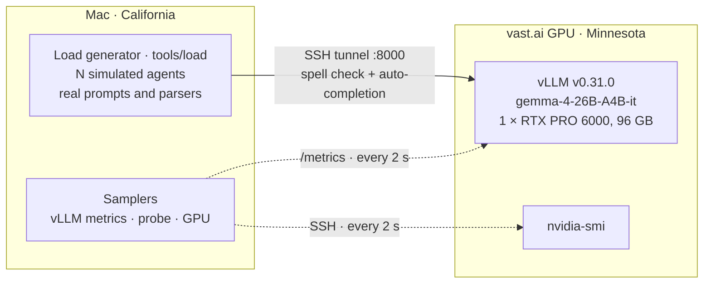

# Load test report: auto-completion and auto-correction

**How many agents typing at once can one GPU serve?**

Date: 2026-11-10 · Branch: `load-test-openspec` · Raw measurements and every run's settings: `docs/load-test-architecture.md`

## Result

One **NVIDIA RTX PRO 6000 (96 GB)** running **`google/gemma-4-26B-A4B-it` on vLLM v0.31.0** serves:

- **up to about 100 agents typing at once with no loss of quality**: about 75% of suggestions arrive before the agent types on, the same as with 25 agents;
- **200 agents with a mild loss** (69% useful) and **300 agents with a clear loss** (61% useful), still with **no failed or timed-out request** in 16,771;
- at **$0.018 per agent-hour at 100 agents** ($1.78/h for the card).

The limit is the card's compute as more requests share each step, not memory: vLLM never queued a request and its cache stayed under 17% full. At light load the largest part of each request's time is distance (about 150 ms of 250 ms through the SSH tunnel), not the model. The typing behaviour behind these figures is **assumed, not measured** (see Agent behaviour); real pause lengths would move every useful-answer figure.

## Architecture

Second path, measured on Gemini only: load generator → demo server (`server/index.ts`: Basic auth, prompts) → hosted LLM, the path the page uses.

- **What is real:** the requests (built by the product's own message builders, `src/assistant/llm.ts`, with the server's system messages and examples), the model, the GPU, the network path, aborts.
- **What is simulated:** the agents typing (below).
- **Targets:** vLLM directly (the model and the card), the demo server (the whole path the page uses), and a built-in fake for tests.

## Load test organization

- **Tool:** `npm run load` in this repository (`tools/load/`, plain TypeScript, 230 automated tests; every rule checked on a virtual clock with no network or GPU).
- **Load in stages:** agents are added in steps (here 25 → 50 → 100 → 200 → 300), each stage held for 180 s; the first 30 s of each stage are warm-up and left out of the figures. No early stop, no pass rule: every stage runs and reports figures.
- **Measured per request:** outcome, latency, the time the agent left for it, sizes. Per stage: useful answer rate, aborts, failures, latency percentiles, requests in flight.
- **Measured on the instance:** vLLM's own metrics every 2 s (running, waiting, cache, tokens per second, prefix cache), the GPU with `nvidia-smi` every 2 s over SSH, a one-token probe every 10 s for distance, and the loader's own event loop delay to prove it kept up.
- **Run on a rented GPU** through the sibling project's vast.ai scripts, ended with destroy and a status check. Synthetic text only: no real customer or agent data leaves the Mac.
- **Built in four steps** (OpenSpec changes, each archived with its specs): load generator → demo server as a target → vLLM metrics, probe and cost → GPU sampling and the capacity run.

## Agent behaviour

Each simulated agent types real support-chat replies (98 synthetic conversations, 310 agent turns, half English and half Arabic) the way the page's assistant sees typing:

1. **Types in bursts** of whole words (median 3 words) at 40 words per minute (each agent ±25%), with a typo in about one word in 15.
2. **Pauses** after each burst (median 1.8 s, long-tailed). A pause shorter than the **1 s debounce** sends nothing.
3. **After the debounce** sends both requests at once, as the assistant does: **spell check** and **auto-completion**, each with the full context (about 3,500 tokens). One round in ten sends spell check only (an edit in mid-text).
4. **Resumes typing** when the pause ends and **aborts** whatever has not answered; an answer counts as **useful** only if it arrived before that.
5. **Accepts** 26% of the completions that arrive in time (the draft jumps ahead), then **sends the message** and waits about 20 s for the customer before the next reply.

A seed fixes all of it, so a run can be repeated. These inputs are assumptions: with them, the median request gets about 0.8 s before the agent types on, which caps the useful rate at about 75–80% however fast the model is.

## Table 1: capacity of one GPU

`gemma-4-26B-A4B-it` on vLLM v0.31.0, 1 × RTX PRO 6000 WS, straight to vLLM through the tunnel; 180 s stages, figures after 30 s of warm-up.

| Agents | Requests | Useful answers | Latency p50 / p95 / p99 | vLLM running (mean / max) | vLLM queue | Generated tokens/s | GPU busy | GPU power | Cost per agent-hour |
|---:|---:|---:|---|---|---:|---:|---:|---:|---:|
| 25 | 531 | 75.3% | 246 / 586 / 1061 ms | 0.6 / 4 | 0 | 57 | 33% | 155 W | $0.071 |
| 50 | 1,149 | 78.1% | 274 / 645 / 1015 ms | 1.5 / 7 | 0 | 127 | 62% | 224 W | $0.036 |
| **100** | **2,132** | **75.4%** | **311 / 859 / 1293 ms** | **3.5 / 10** | **0** | **254** | **90%** | **312 W** | **$0.018** |
| 200 | 4,281 | 68.9% | 400 / 1091 / 1908 ms | 10.1 / 22 | 0 | 475 | 100% | 373 W | $0.009 |
| 300 | 6,431 | 61.3% | 516 / 1322 / 2221 ms | 19.7 / 38 | 0 | 617 | 99% | 426 W | $0.006 |

No failed, timed-out or unreadable request in any stage. Not useful = the agent typed on first. KV cache at most 17% full; prefix cache served 89–94% of prompt tokens. Loader event loop delay p99 about 12 ms in every stage (it kept up). "GPU busy" is the share of time a kernel ran, not how full the card was.

## Table 2: all runs compared

| Run | Path | Agents | Requests | Useful answers | Latency p50 / p95 | Upstream calls nobody used |
|---|---|---:|---:|---:|---|---:|
| Hosted model | Gemini 3.5 Flash-Lite, direct | 3 | 65 | 53.8% | 718 / 912 ms | — |
| Hosted model | Gemini, through the demo server | 3 | 67 | 62.7% | 772 / 966 ms | 37.3% |
| Hosted model | Gemini, through the demo server | 50 | 1,051 | 64.2% | 663 / 861 ms | 36.3% |
| Rented GPU | vLLM direct (confirmation) | 3 | 62 | 85.5% | 269 / 600 ms | — |
| Rented GPU | vLLM direct | 100 | 2,132 | 75.4% | 311 / 859 ms | — |
| Rented GPU | vLLM direct | 300 | 6,431 | 61.3% | 516 / 1322 ms | — |

- The **fast self-hosted model** answers in about a third of Gemini's time, which raises the useful rate from about 55–65% to 75–85%.
- **Gemini showed no limit up to 50 agents:** a hosted endpoint scales behind itself, so it says nothing about one card.
- **The demo server does not cancel** the model call when the page aborts: 36–45% of its upstream calls served no one and were still paid for (server review, finding 1).
- **Aborts do reach vLLM** through the tunnel: 20 long generations running at the abort, 0 one second later.

## Conclusions and next steps

- **Size at about 100 concurrent typing agents per RTX PRO 6000** for this model, with 200 as a ceiling where quality visibly drops. Cost at 100 agents: under 2 cents per agent-hour plus the server.
- **Put the model next to the server.** About 150 ms of every request is the tunnel and network; removing it would lift the useful rate more than a faster card.
- **Cancel upstream calls on abort in the demo server** before any shared use: over a third of model calls are wasted today.
- **Measure real typing** (pause lengths above all): every useful-answer figure here rests on assumed pauses.
- Later comparisons (one card, one setting changed each): output cap, JSON mode, prefix cache, `--max-num-seqs`.

Limits of this test: one card and one model; the loader ran in California through one SSH tunnel; typing inputs assumed; each run once with seed 1; the demo server was measured on Gemini only, not on the GPU.
