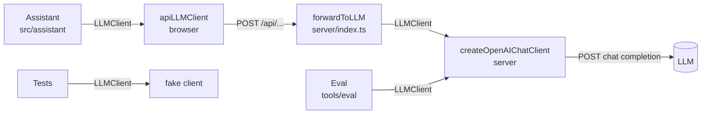
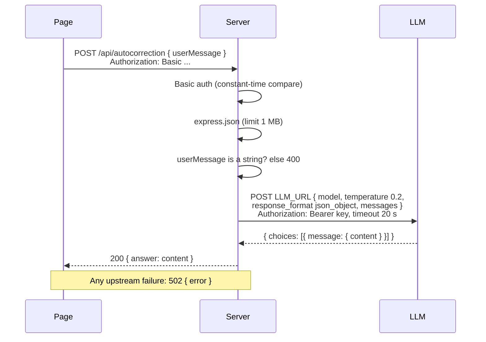
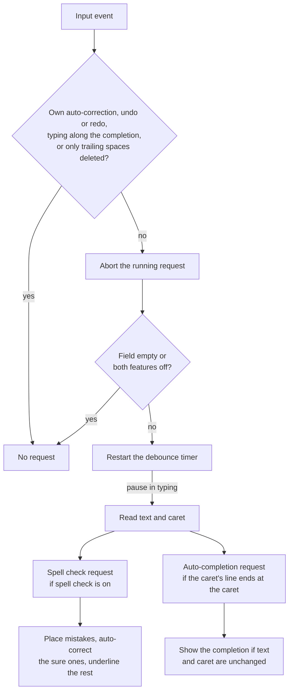

# Server architecture and review

Reviewed on 2026-11-09 at commit `930f2c2`. Scope: `server/` (392 lines in four files), the scripts and configs that run it, and its contract with the page.

## Summary

The server is a thin, authenticated proxy between the demo page and an OpenAI-compatible LLM. It does three things: guards everything with Basic auth, forwards two kinds of request to the LLM with the key and the prompts, and serves the page.

It does that job correctly and the design is sound for a demo. The key and the prompts never reach the browser, auth covers every route, and the same `LLMClient` interface is used by the browser, the server and the eval.

The main weaknesses, all confirmed by running the server against a fake LLM:

1. **Aborted requests are still paid for.** When the browser cancels, the upstream LLM call runs to completion.
2. **No cap on the answer or a tight cap on the request.** No `max_tokens`, and a 1 MB body limit.
3. **Errors leak detail.** Malformed JSON returns an HTML stack trace with file paths; upstream error text is passed to the browser verbatim.
4. **The packaged bundle does not load `.env`** and is not documented.

None of these blocks the demo. Items 1 and 2 matter as soon as the page is shared with more than a few people.

---

## Part 1: Architecture

### Purpose

The page must not hold the LLM key and must not call the LLM directly (a hard constraint of the project). The server exists to hold the key, hold the prompts, and give the page a same-origin endpoint.

### Components

| File | Lines | Responsibility |
|---|---|---|
| `server/index.ts` | 81 | Process entry. Reads the environment, builds the Express app: Basic auth, JSON body parsing, the two API routes, then either Vite middleware (dev) or static files from `dist/` |
| `server/openai-chat-client.ts` | 49 | The upstream `LLMClient`. Builds the chat messages (system message, examples, user message) and posts them as an OpenAI-style chat completion |
| `server/spell-check-prompt.ts` | 112 | System message and nine example exchanges for spell check |
| `server/auto-completion-prompt.ts` | 150 | System message and ten example exchanges for auto-completion |

Supporting files outside `server/`:

| File | Role |
|---|---|
| `src/assistant/types.ts` | Source of the shared `LLMClient` and `LLMRequestKind` types. The server imports types only, no code |
| `src/app/lib/llm-client.ts` | The browser's `LLMClient`: posts `{ userMessage }` to the server |
| `tools/eval/spell-check.ts` | Calls `createOpenAIChatClient` directly, so the eval tests the same prompts the server sends |
| `vite-server.config.js` | Bundles the server and Express into one file, `server-dist/server.js` |

### One interface, three implementations

`LLMClient.ask(userMessage, signal, requestKind)` returns `{ answer }` or `{ error }` and never throws. It is implemented three times:

This is the best part of the design. The assistant does not know whether it talks to a server, a fake or the LLM itself, and the eval exercises the real upstream client with the real prompts.

### Split of responsibilities

| Concern | Owner |
|---|---|
| The user message (context, word lists, draft with the caret mark) | Assistant, in the browser |
| Parsing the answer JSON | Assistant, in the browser |
| System message and examples | Server |
| Model, URL, key, temperature, response format | Server |
| Timeout | Both: 20 s in the assistant, 20 s in the server |

The server treats the user message and the answer as opaque strings. It does not validate that the answer is JSON or has the expected shape.

### Request flow

The page sends the two request kinds in parallel after each pause in typing, so the server normally handles two concurrent upstream calls per user.

The `messages` array for each kind is `[system, example user, example assistant, ..., user]`. The prefix up to the last message is built once at start-up and is identical for every request, which suits provider-side prompt caching.

### Middleware order

1. Basic auth, on every request.
2. `express.json({ limit: '1mb' })`.
3. `POST /api/autocorrection` and `POST /api/autocompletion`.
4. Dev: Vite middleware (source with hot reload). Production: `express.static(dist)` and `index.html` for any other GET.

`app.listen` is called before step 4 is attached. In dev the Vite server is created with the same HTTP server for its WebSocket.

### API contract

Both routes take and return the same shapes.

| | |
|---|---|
| Routes | `POST /api/autocorrection` (spell check), `POST /api/autocompletion` |
| Request body | `{ "userMessage": string }`, `Content-Type: application/json` |
| 200 | `{ "answer": string }`: the model's message content, expected to be JSON text |
| 400 | `{ "error": "body must be {\"userMessage\": \"...\"}" }` when `userMessage` is not a string |
| 400 | HTML error page when the body is not valid JSON (see finding 3) |
| 401 | Empty body with `WWW-Authenticate: Basic realm="SpellCheckingPrototype"` |
| 413 | HTML error page when the body is over 1 MB |
| 502 | `{ "error": string }` for any upstream failure: non-2xx status, timeout, network error, unreadable or empty answer |

### How the assistant uses the two routes

This is the caller's side of the contract. It lives in the browser, in `src/assistant/check-while-typing.ts` and `llm.ts`, and explains the traffic the server sees. The assistant sends both requests together after a pause in typing, and handles each answer on its own as it arrives.

#### When a request is scheduled

Every input event restarts a debounce timer (1000 ms in the demo) and aborts any request still running. Four kinds of input do not schedule a request:

- the assistant's own auto-correction edit;
- undo and redo;
- typing that matches the shown auto-completion while some of it is left;
- deleting only trailing spaces since the last request.

Nothing is sent if the field is empty or both features are off. Escape cancels the timer and the running request.

#### What is sent when the timer fires

The assistant reads the text and the caret once, then sends up to two requests in parallel under one abort controller, each with a 20 s timeout.

| | Spell check (`/api/autocorrection`) | Auto-completion (`/api/autocompletion`) |
|---|---|---|
| Sent when | Spell check is on | Auto-completion is on, the caret is known, no input method is composing, and the rest of the caret's line is empty |
| User message | LLM context, custom dictionary, draft with `‸` at the caret | LLM context, draft with `‸`, and "Complete the draft at ‸ with one short sentence" (plus a note when the caret is on a new line) |
| Expected answer | `{"mistakes": [{word, context, fixes, sure}]}` | `{"nextSentence": "..."}` |

The assistant builds only the user message. The server adds the system message and examples by request kind. Ignored words are not sent to the LLM.

#### What happens with the spell check answer

1. Each mistake is located in the current text by its word and surrounding context, not by offset, so it still lands if the text moved.
2. Earlier mistakes the model did not repeat are kept if their word was finished when reported and is unchanged.
3. In auto-correction mode, a mistake is replaced with its first fix when it is marked sure, the caret is not at the word's end, a non-word character follows it, and it is not an ignored word. Each replacement is one undo step, the caret is put back, and the word flashes.
4. Everything else is underlined; the popover offers the fixes.

#### What happens with the auto-completion answer

It is shown only if the text and caret are the same as when the request was sent. An auto-correction applied by the same round counts as unchanged, and the completion shifts with it. An empty `nextSentence` shows nothing.

#### After the answers

- **Aborted:** both answers are dropped. The server is not told (see finding 1).
- **Failed:** if either request fails, the status shows "LLM request failed" for 2 s; the other answer is still used.
- **Accepting the whole completion** (Tab or →) counts as typing, so it schedules the next request.
- **Accepting one word** or typing along with the completion keeps the rest and sends nothing.

#### What this means for server load

- Each pause in typing costs up to two upstream calls, each carrying the full LLM context.
- Each keystroke after a pause aborts both calls in the browser, and the server currently lets them finish upstream.

### Configuration

All from the environment. The server exits at start-up with a clear message if a required one is missing.

| Variable | Required | Meaning |
|---|---|---|
| `LLM_API_KEY` | yes | Bearer token for the LLM |
| `LLM_URL` | yes | Full URL of an OpenAI-compatible chat completions endpoint |
| `MODEL` | yes | Model name sent in the request |
| `BASIC_AUTH_USER`, `BASIC_AUTH_PASSWORD` | yes | The one shared login |
| `PORT` | no | Default 8787 |

Fixed in code: bind address `127.0.0.1`, upstream timeout 20 s, temperature 0.2, `response_format: json_object`, body limit 1 MB.

### Run modes

| Mode | Command | Page comes from | `.env` loaded by |
|---|---|---|---|
| Dev | `npm run dev` | Source, through Vite middleware, hot reload | `process.loadEnvFile` in `index.ts` |
| Production | `npm start` | `dist/` (built first) | `node --env-file=.env` |
| Packaged | `npm run package`, then `node server-dist/server.js` | `dist/` next to `server-dist/` | Nothing (see finding 4) |

Node runs the TypeScript directly (type stripping), which is why the code uses `erasableSyntaxOnly` and `.ts` import extensions. There is no compile step for dev or production.

### Security model

| Asset or threat | Protection | Gap |
|---|---|---|
| LLM key | Only in the server's environment; never in a response or a log | None found |
| Prompts | Only on the server | None found |
| Anonymous access | Basic auth on every route, constant-time compare | No attempt limit; one shared login |
| Network exposure | Binds to `127.0.0.1`; sharing goes through ngrok, which adds TLS | Plain HTTP if ever bound elsewhere |
| Cross-site requests | Only `application/json` bodies are parsed and there is no CORS header, so another site cannot post a readable request | None found |
| Cost abuse by a logged-in user | None | No rate limit, 1 MB body, no `max_tokens` |
| Customer data in the context | Not logged by the server | Sent in full to the LLM provider on every pause in typing |

---

## Part 2: Review

### What is good

- **Small and readable.** Four files, each with one job. Names carry the meaning.
- **Fails fast on configuration.** Missing variables stop the process with the name of the variable.
- **Never throws to the client.** The upstream client turns every failure into `{ error }`, and the route maps that to 502.
- **Auth is done properly.** Length check plus `timingSafeEqual`, applied before body parsing so unauthenticated bodies are never read.
- **Logs are safe.** One line per request with kind, outcome and latency; no draft text, no context, no key.
- **Prompts are data.** Each is a system message plus example exchanges, kept apart from transport code and shared with the eval.

### Findings

All behaviours below were observed by running the server against a local fake LLM, unless marked "from reading".

#### 1. Aborted browser requests keep running upstream (high for cost)

`server/index.ts:68` passes only `AbortSignal.timeout(20000)` to the client. Nothing listens for the browser closing the connection.

Observed: a client that gave up after 1 s on a 4 s upstream call; the fake LLM still served the full 4 s and the server logged `answered in 4004 ms`.

The page aborts its running requests on every keystroke after a pause. Each abort leaves two upstream calls running and billed, with their answers thrown away.

Fix: create an `AbortController` per request, abort it on `response.on('close')` when the response is not finished, and combine it with the timeout using `AbortSignal.any`.

#### 2. No bound on answer size, loose bound on request size (medium)

- `openai-chat-client.ts:28` sends no `max_tokens`. A model that rambles is paid for and waited on up to the 20 s timeout. Both answers are small by design (a short JSON list, one sentence).
- The body limit is 1 MB, roughly 250,000 tokens. The largest preset context is about 4 KB.
- There is no rate limit or concurrency limit.

Together these let any logged-in user, or a page bug, run up the LLM bill. Fix: `max_tokens` per request kind, a body limit near 64 KB, and a simple per-process concurrency cap.

#### 3. Error responses leak detail and break the JSON contract (medium)

- Malformed JSON returned an HTML page with a stack trace and absolute file paths (`/Users/.../node_modules/body-parser/...`). Express does this whenever `NODE_ENV` is not `production`, and no script sets it. The 413 response is the same kind of page.
- Upstream error text is forwarded as is. Observed: `{"error":"HTTP 429: rate limited, org acme-123"}`. Provider messages can include account or organisation identifiers.
- The page's client handles the HTML case (it falls back to `HTTP 400`), so nothing breaks, but the API is not consistently JSON.

Fix: add one error-handling middleware that returns `{ error }` as JSON with no stack, and set `NODE_ENV=production` in the `server` script. Log the upstream detail on the server and return a short generic reason to the browser. Note the Debugger currently shows the upstream reason, which is useful in a demo; keep it if that is intended and accept the leak knowingly.

#### 4. The packaged bundle is incomplete and undocumented (medium)

- `npm run build-server` and `npm run package` exist and work, but CLAUDE.md and the README do not mention them.
- `server-dist/server.js` does not load `.env`: `process.loadEnvFile` runs only with `--dev`, and the `--env-file` flag is in the `server` script, not in the bundle. Run as documented nowhere, it exits with `LLM_API_KEY is not set` (from reading).
- `.gitignore` lists `server.js`, but the build writes `server-dist/`, which is not ignored.
- `vite-server.config.js` points at `server/index.js` (it resolves to the `.ts` file) and is full of comments, against the project's own rule.

Fix: load `.env` when it exists in every mode (`process.loadEnvFile` inside a check), ignore `server-dist/`, and document the package flow or delete it.

#### 5. Every upstream failure is a 502 (low)

Timeouts, upstream 429 and upstream 401 all become 502. The page cannot tell "slow down" from "the key is wrong" from "took too long", and neither can anyone reading access logs. Mapping timeout to 504 and upstream 429 to 429 would be enough.

#### 6. Two timeouts with the same value (low)

The assistant and the server both wait 20 s. They race, so the same slow call ends sometimes as a browser `TimeoutError` and sometimes as a server 502. Make the server's shorter (for example 15 s) so the server's answer always wins and is logged.

#### 7. Upstream request assumes one flavour of "OpenAI-compatible" (low)

`temperature: 0.2` and `response_format: { type: 'json_object' }` are sent to every model. Some compatible endpoints and reasoning models reject one or both, and the result is a 502 on every request with the reason only in the Debugger. The answer's `finish_reason` is not checked, so a truncated answer surfaces later in the browser as "unreadable answer". From reading.

#### 8. Small items (low)

- **Auth accepts a header without the `Basic` scheme.** `Authorization: dTpw` returned 200. Harmless (the credentials are still required) but not what the code intends.
- **Any GET falls back to `index.html`.** `GET /api/nope` returned 200 HTML. API paths should return 404.
- **`X-Powered-By: Express`** is sent. `app.disable('x-powered-by')` removes it.
- **The hot-reload WebSocket is not behind Basic auth.** Upgrade requests do not pass through Express middleware, so the claim in CLAUDE.md that hot reload is "behind the same Basic auth" holds for HTTP only. Dev mode only; it matters only if dev mode is shared through ngrok. From reading.
- **`PORT` is not validated.** A non-numeric value becomes `NaN`.
- **No shutdown handling.** In-flight upstream calls are dropped on SIGTERM. Fine for a demo.
- **No tests for the server.** The page tests fake `/api/**`, so auth, validation and error mapping are untested. The eval covers the upstream client only with a real key.

### What I did not find

- No path where the key reaches a response, a log line or the bundle served to the browser.
- No route reachable without auth (the dev WebSocket aside).
- No unhandled rejection in the request path: `llmClient.ask` catches everything, and Express 5 forwards any other async error to its handler.

### Recommendations, in order

1. Cancel the upstream call when the browser disconnects (finding 1). About ten lines.
2. Add `max_tokens` per request kind and lower the body limit (finding 2).
3. Add a JSON error handler and set `NODE_ENV=production` for `npm run server` (finding 3).
4. Decide whether the packaged bundle is a supported way to deploy. If yes, make it load `.env`, ignore `server-dist/` and document it; if no, remove the two scripts and the config (finding 4).
5. Add a small server test file: start the app with a fake upstream and check 401, 400, 200, 502 and the abort. This needs `index.ts` to export a function that builds the app instead of starting it at import.
6. Map upstream timeout and 429 to their own status codes, and shorten the server timeout (findings 5 and 6).

For production use beyond a demo, the larger steps would be per-user identity instead of one shared login, a rate limit per user, and an agreed position on sending conversation and customer profile text to the LLM provider.
